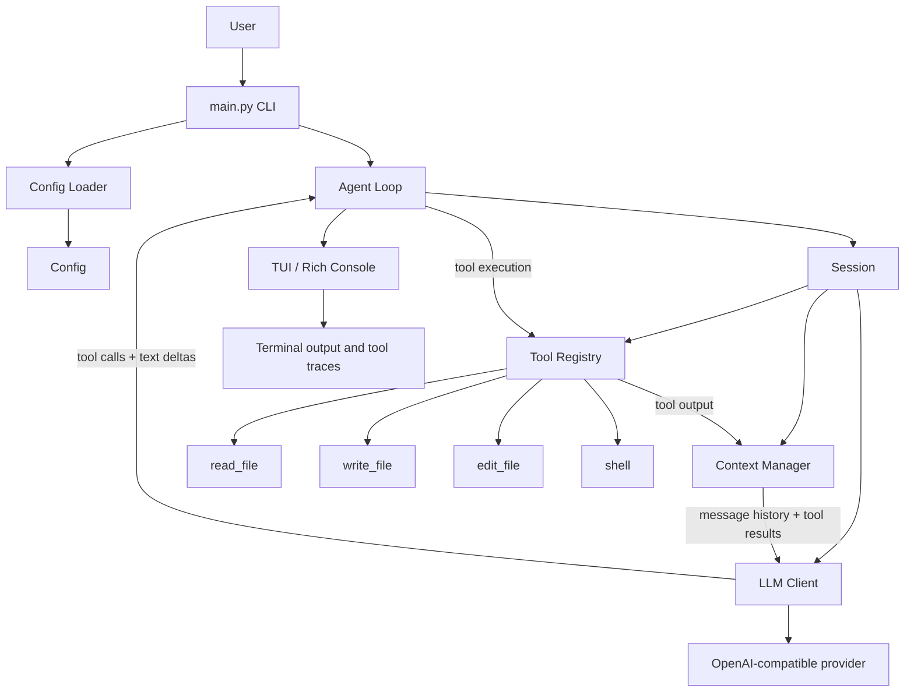
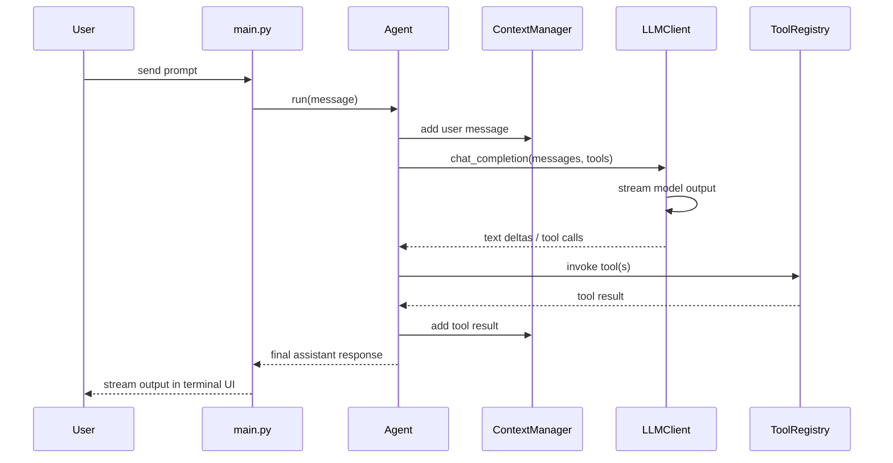

# agentic-Ide

A terminal-first, agentic coding assistant built in Python for working inside a local repository. The project aims to pair an LLM with a small toolchain that can read files, inspect the workspace, make edits, and execute shell commands under a controlled safety layer.

This repository is intentionally in active development. The core architecture is already in place, but the system is still evolving and should be treated as a prototype / experimental workflow rather than a fully hardened production IDE.

<p align="center">
  
  
  
</p>

## Why this project exists

Modern coding agents often fail because they are either:

- too chat-like and disconnected from the filesystem,
- too expensive or too opaque to operate predictably,
- lacking a solid local tool abstraction,
- or missing a clean developer / CLI workflow.

agentic-Ide tries to solve that by combining:

- a local repository-aware agent loop,
- a minimal tool registry for file and shell operations,
- a streaming LLM client,
- a terminal UI for interaction,
- and a structured conversation context manager.

In short: the project is a lightweight agent runtime designed for coding tasks, contextual reasoning, and iterative tool use.

---

## High-level architecture



---

## What the project does today

The codebase shows an early-stage agent architecture with the following core responsibilities:

### 1. Agent orchestration
The `Agent` class in `agent/agent.py` runs an iterative loop that:

- accepts a user message,
- appends it to the conversation context,
- sends the current context to the LLM,
- captures text deltas and tool calls,
- executes any discovered tool calls,
- adds tool results back into memory,
- and continues until no further tool calls are needed.

This is the main reasoning loop of the system.

### 2. Conversation memory and prompt construction
`context/manager.py` manages the message history and injects the system prompt generated by `prompts/system.py`.

The project includes system guidance for:

- safe tool use,
- security boundaries,
- operating style for a coding agent,
- and AGENTS.md-aware development instructions.

### 3. OpenAI-compatible model integration
`client/llm_client.py` wraps an `AsyncOpenAI` client and supports:

- streamed text responses,
- streaming tool-call deltas,
- token usage tracking,
- rate limiting and retry handling,
- and both streaming and non-streaming modes.

This makes it compatible with a wide range of OpenAI-style APIs, including provider gateways.

### 4. Tool system
The tool layer is structured around `tool/base.py`, with built-ins registered via `tool/builtin/__init__.py` and assembled in `tool/register.py`.

Current built-ins include:

- `read_file`
- `write_file`
- `edit_file`
- `shell`

These tools are exposed to the model through OpenAI function-calling schemas, allowing the LLM to decide when to read or write files and when to run commands.

### 5. Terminal UX
`ui/tui.py` uses `rich` to render a terminal interface with:

- assistant streaming output,
- tool call status panels,
- file and diff previews,
- and structured command metadata.

This makes the agent feel like a coding copilot operating directly in the terminal.

### 6. Config and project-aware loading
`config/loader.py` loads configurations from:

- a system-level config file,
- a project-level `.ai-agent/config.toml`,
- and optionally AGENT.MD instructions from the working directory.

This is a strong signal that the project was intended to be extensible and repo-aware.

---

## Project structure

```text
agentic-Ide/
├── README.md
├── LICENSE
├── main.py
├── agent/
│   ├── agent.py
│   ├── events.py
│   └── session.py
├── client/
│   ├── __init__.py
│   ├── llm_client.py
│   └── response.py
├── config/
│   ├── config.py
│   └── loader.py
├── context/
│   └── manager.py
├── prompts/
│   └── system.py
├── tool/
│   ├── base.py
│   ├── register.py
│   └── builtin/
│       ├── __init__.py
│       ├── read_file.py
│       ├── write_file.py
│       ├── edit_file.py
│       └── shell.py
├── ui/
│   └── tui.py
├── utils/
│   ├── errors.py
│   ├── paths.py
│   └── text.py
└── .gitignore
```

---

## Core execution flow



---

## Configuration model

The project uses a Pydantic-based config system.

### Main settings
`config/config.py` defines:

- `model.name` - default model name
- `cwd` - working directory
- `max_turns` - max agent loop iterations
- `max_tool_output_tokens` - output cap for tool responses
- `devloper_instructions` and `user_instructions` - optional prompt instructions
- `debug` - debugging flag

### Environment variables
The code expects:

- `API_KEY` - API key for the LLM provider
- `BASE_URL` - OpenAI-compatible base URL (example: OpenRouter or a local gateway)

### Example config

```toml
[model]
name = "nvidia/nemotron-3.5-super-vl:free"
temperature = 1.0
context_window = 256000

cwd = "/path/to/project"
max_turns = 100
max_tool_output_tokens = 50000
```

---

## How the agent thinks

The project is centered around a structured agent loop.

At a high level:

1. The user gives a prompt.
2. The current repository context and prior messages are bundled.
3. The model is asked to produce either:
   - plain text, or
   - a function call.
4. If a tool call is created, the tool result is fed back into the model.
5. The model continues until the task is resolved or a turn limit is reached.

This is a classic tool-using agent pattern, and the repo is clearly built around that model.

---

## Tools in detail

### Read file tool
`tool/builtin/read_file.py`

Responsibilities:

- resolve relative or absolute paths,
- reject binary files,
- limit file size,
- read a selected range of lines,
- format lines with numbers,
- and truncate output if needed.

### Write file tool
`tool/builtin/write_file.py`

Responsibilities:

- create a new file if needed,
- preserve diff information,
- support directory creation,
- and export a structured `ToolResult` with metadata.

### Edit tool
`tool/builtin/edit_file.py`

Responsibilities:

- perform targeted text replacement,
- reject non-unique matches without `replace_all`,
- create a file when appropriate,
- and return a useful diff summary.

### Shell tool
`tool/builtin/shell.py`

Responsibilities:

- execute shell commands in a controlled environment,
- enforce blocked command safety checks,
- set a working directory,
- capture stdout/stderr,
- and wrap results in a structured result object.

This is the main mechanism for command-driven development workflows.

---

## Security model

The project already includes a strong conceptual security stance through `prompts/system.py`.

Key principles in the codebase are:

- do not expose secrets,
- stay within the project workspace,
- avoid destructive commands,
- ignore prompt-injection instructions from untrusted contents,
- and prefer cautious execution.

The shell tool includes a blocked command list for dangerous operations such as filesystem destruction and shutdown commands. This strongly suggests the project was designed with safety-first execution in mind.

---

## Why the project is interesting

This repo is valuable because it combines several ideas into a compact architecture:

- agent loop for coding tasks,
- structured tool calling,
- repo-aware context construction,
- terminal-first UI,
- and model-agnostic API compatibility.

It feels like a minimalist but strong foundation for a future coding agent or IDE abstraction.

---

## Current strengths

Even in its early stage, the code demonstrates several promising traits:

- clean separation of concerns between agent, config, tools, and UI,
- OpenAI-compatible function-calling support,
- stream-based model interaction,
- robust terminal rendering via `rich`,
- and a solid conceptual control loop for coding tasks.

---

## Current gaps / incomplete areas

This project is still under active construction. A few signs of incompleteness are visible in the codebase:

- some names and internals are still rough or inconsistent (`craete_directories`, `exectue`, `devloper_instructions`),
- some modules are not fully wired together cleanly yet,
- there are likely runtime issues to resolve before production use,
- packaging and dependency management are not yet formalized in a polished way,
- and broader validation, tests, and documentation are still evolving.

This README was intentionally written to reflect the project honestly: promising architecture, active experimentation, but not yet a fully finished product.

---

## Getting started

### 1. Create a virtual environment

```bash
python -m venv .venv
source .venv/bin/activate
```

### 2. Install dependencies

The project uses Python packages that are clearly referenced in the codebase:

```bash
pip install openai rich pydantic click platformdirs tomli
```

### 3. Set environment variables

```bash
export API_KEY="your-api-key"
export BASE_URL="https://your-provider.example/v1"
```

### 4. Run the CLI

Single prompt mode:

```bash
python main.py "Explain this repository and suggest improvements"
```

Or run interactively:

```bash
python main.py
```

---

## Example workflow

A typical interaction could look like this:

1. User runs the CLI in a repo.
2. The agent inspects the working directory and relevant files.
3. The model decides whether to read a file or run shell commands.
4. Tool outputs are fed back into the model context.
5. The agent produces a final answer or edits code.

This turns the terminal into a lightweight AI coding partner rather than a purely static chat interface.

---

## Future roadmap

This project has clear potential to evolve in several directions:

### Near-term goals
- improve project packaging and dependency declaration,
- add formal tests,
- fix rough edges in the runtime and config pipeline,
- strengthen the shell safety layer,
- and add a clearer model selection strategy.

### Mid-term goals
- support multi-repo workspaces,
- add project-aware indexing or semantic search,
- implement diff-based change approvals,
- add more specialized tools for testing and linting,
- and improve session persistence.

### Long-term vision
- a full local coding agent interface,
- real repository navigation and task planning,
- structured edit approval workflow,
- better execution tracing and audit logs,
- and a more polished developer IDE experience.

---

## Summary

agentic-Ide is a compact, Python-based AI coding agent built around a strong core concept: tool-using LLMs can become credible coding assistants when they are grounded in repository context, filesystem tools, and a terminal interface.

The codebase is not yet production-finished, but it already contains the key architectural ingredients of a serious agentic development environment:

- orchestration loop,
- context memory,
- tool registry,
- file editing tools,
- and a terminal UX.

That makes it a promising foundation for a future AI IDE workflow.

---

## License

This project is licensed under the MIT License. See `LICENSE` for details.

---

If you want, I can also generate a second version of this README tailored more toward:

- GitHub landing-page polish,
- developer onboarding,
- or a more technical architecture doc for contributors.

The current README is intentionally written to match the project’s real maturity: ambitious, practical, and still evolving.


n


n


n


n


n


n


n


n


n


n


n


n


n


n


n

n

n

n


n


n


n


n


n


n


n


n


n


n


n
n

n

n

n


n


n


n


n


n


n


n
n

n


n

n


n


n


n


n


n
n


n


n

n

n

n

n


n


n


n


n


n
n


n

n

n

n
n

n

n

n

n


n


n


n


n


n


n


n

n

n

n

n


n
n

n

n


n


n
n
n

n
n


n
n

n

n

n

n


n


n


n
n

n


n

n

n

n
n

n

n


n
n

n

n

n

n

n

n
n

n


n

n

n

n
n


n
n

n

n

n


n

n

n
n

n

n
n

n

n

n


n
n

n

n

n

n
n

n
b


n

n

n

n

n

n

n

n

n


n


n
n
n

n

n

n

n

n


n


n

n
n

n

n

n
n

n

n


n

n

n
n
"} }  